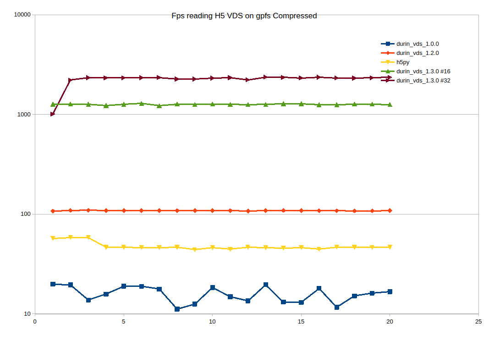

# Changelog

All notable changes to the Durin VDS project will be documented in this file.
## [1.3.1] -  2025-12-11
### Known Issues
 - **Relative Absolute Path** - Resolved Issue with relative path and symbolic links resolution
 - ** Race competition** - Segmentation fault. Race competition on the scratch 

## [1.3.0] - 2025-12-02
### Added
- **Multi-threading support:** Implemented true parallel file reading.
- **Direct OS I/O:** Replaced the HDF5 library's internal chunk I/O with direct system calls (`pread`) and local memory buffers.

### Changed
- **Performance:** Bypassed the HDF5 Global Lock entirely during the read phase.
- **Throughput:** Significantly increased read bandwidth on GPFS systems by allowing concurrent access from multiple threads.

## [1.2.0] - 2025-11-28
### Added
- **"Direct Chunk" read path:** Implemented a new reading strategy for VDS datasets.

### Changed
- **Optimization:** Moved VDS mapping logic to the initialization phase (startup) rather than per-frame execution.
- **Decompression:** Manually handles Bitshuffle/LZ4 decompression after raw data transfer, bypassing the standard HDF5 filter pipeline overhead.

## [1.1.0]
- **[YANKED]**
*Internal release. Withdrawn due to instability.*

## [1.0.0] - 2025-11-25
### Added
- Initial implementation of the Durin plugin adapted for Lima2 VDS data.
- Native support for reading Virtual Datasets (VDS), resolving compatibility issues found in Neggia.

### Known Issues
- **Performance:** Read operations on GPFS are slow due to the standard HDF5 library performing repetitive mapping lookups and locking for every frame request.

